# 模拟电路基础学习笔记

> **学习方向：STM32 → FreeRTOS → 机器人控制 → 具身智能（Robot Learning）**
>
> 学习目标：理解硬件工作原理，能够阅读开发板基础原理图、采集传感器信号、使用 GPIO 控制外部负载，并具备基本的电路计算与排障能力。不以成为专业硬件电路设计工程师为目标。

## 目录

1. [知识体系与学习重点](#1-知识体系与学习重点)
2. [电学基础](#2-电学基础)
3. [六大核心电子元器件](#3-六大核心电子元器件)
4. [六种典型电路](#4-六种典型电路)
5. [其他器件、电源与测量](#5-其他器件电源与测量)
6. [STM32 知识对应关系](#6-stm32-知识对应关系)
7. [暂不需要深入的内容](#7-暂不需要深入的内容)
8. [七天学习计划](#8-七天学习计划)
9. [学习验收清单](#9-学习验收清单)
10. [后续具身智能学习路线](#10-后续具身智能学习路线)

---

## 1. 知识体系与学习重点

```text
模拟电路基础
├── 电学基础：电压、电流、电阻、功率、串并联
├── 无源元件：电阻、电容、电感
├── 半导体器件：二极管、三极管、MOS 管
├── 典型电路：限流、分压、上下拉、滤波、去耦、开关
└── 工程实践：稳压供电、万用表、原理图、仿真
                         ↓
STM32：GPIO / ADC / DAC / PWM / I2C / 外设驱动
                         ↓
机器人：传感器采集、电机控制、执行器驱动
```

| 知识模块 | 掌握要求 | 优先级 |
|---|---|---|
| 电压、电流、电阻、功率 | 熟练计算 | ★★★★★ |
| 串联、并联 | 熟练计算 | ★★★★★ |
| 电阻、电容 | 理解特性和典型应用 | ★★★★★ |
| 电感 | 理解储能及感性负载 | ★★★★☆ |
| 二极管、三极管、MOS 管 | 掌握开关及保护用途 | ★★★★★ |
| 限流、分压、上下拉 | 能独立分析及计算 | ★★★★★ |
| RC 滤波、电源去耦 | 理解原理并能读图 | ★★★★☆ |
| 稳压电源、万用表、示波器 | 掌握基础操作 | ★★★★☆ |
| 半导体内部物理、复杂放大电路 | 了解即可 | ★★☆☆☆ |

## 2. 电学基础

### 2.1 电压、电流、电阻

| 物理量 | 符号 | 单位 | 理解 |
|---|---|---|---|
| 电压 | U 或 V | V（伏特） | 两点间电势差，提供电荷运动的驱动力 |
| 电流 | I | A（安培） | 单位时间通过导体截面的电荷量 |
| 电阻 | R | Ω（欧姆） | 对电流的阻碍程度 |
| 功率 | P | W（瓦特） | 单位时间转换或消耗的能量 |

常见单位：1 V = 1000 mV；1 A = 1000 mA = 10⁶ μA；1 MΩ = 1000 kΩ = 10⁶ Ω；1 W = 1000 mW。

- **VCC / VDD**：常见正电源标识；具体含义以芯片资料为准。
- **GND / VSS**：常见参考地标识；GND 是电路参考点，不一定是保护接地。
- **DC**：直流；**AC**：交流。
- **通路**：回路闭合；**断路**：回路断开；**短路**：低阻抗异常连接，可能引起过流。

### 2.2 欧姆定律

$$U=IR,\qquad I=\frac{U}{R},\qquad R=\frac{U}{I}$$

例：3.3 V 电源与 330 Ω 电阻构成闭合回路，电流为 $3.3/330=0.01\,\mathrm{A}=10\,\mathrm{mA}$。

### 2.3 功率与焦耳定律

$$P=UI=I^2R=\frac{U^2}{R}$$

$$Q=I^2Rt$$

后两个功率表达式及焦耳热公式用于欧姆电阻等适用条件。上述电阻耗散功率为 33 mW。选电阻时除阻值还要关注额定功率、温升及余量。

### 2.4 串联与并联

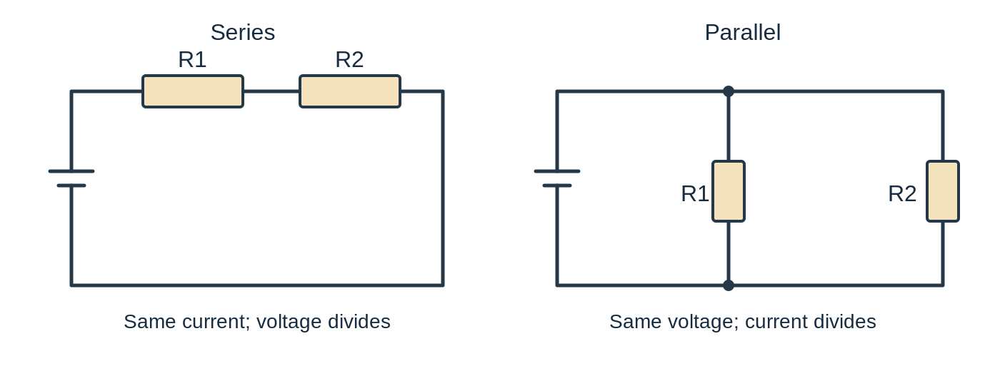

*自绘示意：串联电流相同，并联电压相同。*

串联：

$$R_{eq}=R_1+R_2,\quad I=I_1=I_2,\quad U=U_1+U_2$$

两电阻并联：

$$R_{eq}=\frac{R_1R_2}{R_1+R_2},\quad U=U_1=U_2,\quad I=I_1+I_2$$

**工程补充：** 理解基尔霍夫电流定律（节点流入电流之和等于流出之和）和电压定律（闭合回路电压代数和为零），即可分析简单分支电路，不必先深入复杂网络分析。

## 3. 六大核心电子元器件

### 3.1 电阻（Resistor）

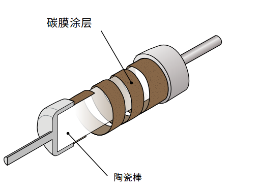

*课程原图：电阻内部结构。*

- 符号 R，单位 Ω；常见参数：阻值、精度、额定功率。
- 限流、分压、上下拉、零欧姆跨接是最重要的应用。
- 光敏电阻：常见型号随光照增强阻值减小；可构成光照采集分压电路。
- 压敏电阻：用于过压、浪涌保护；不必深入材料与工艺。
- 常见贴片标识：`103` = 10 kΩ；`472` = 4.7 kΩ；`1001` = 1 kΩ；`2R4` = 2.4 Ω。特殊编码查数据手册即可。

### 3.2 电容（Capacitor）

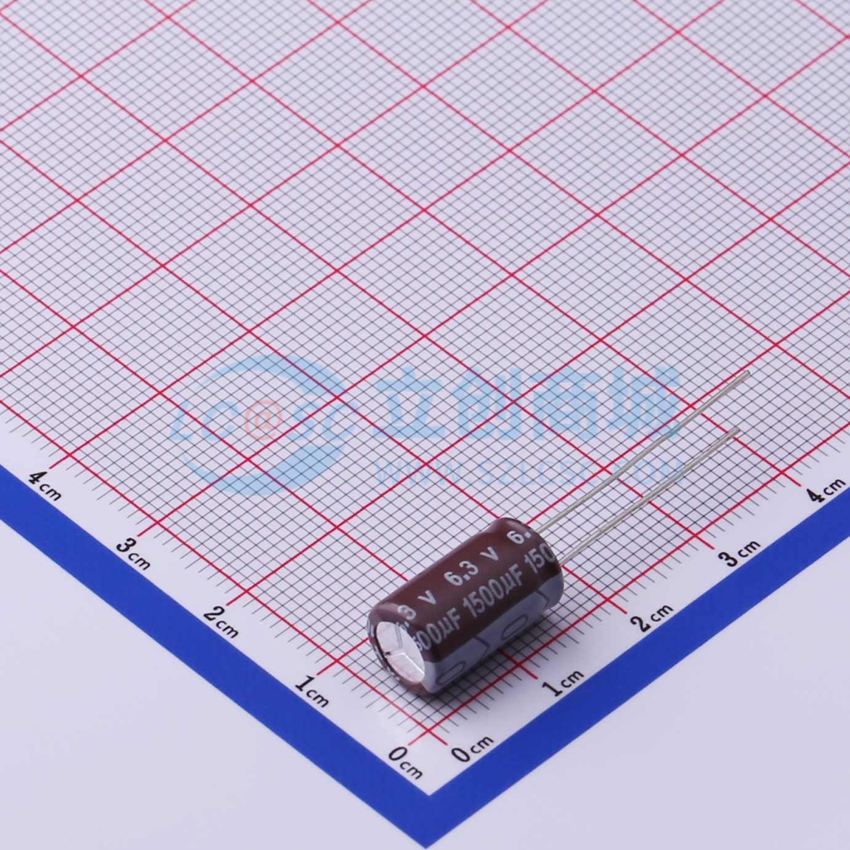 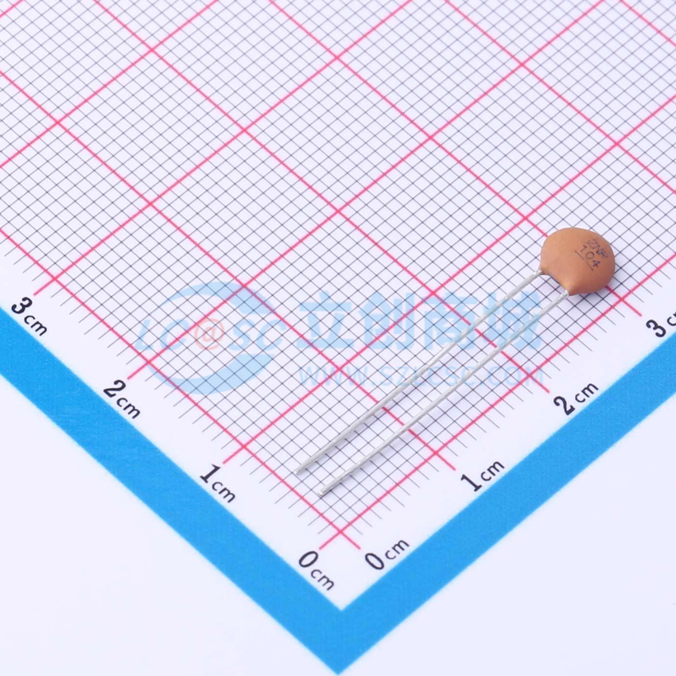

*课程原图：电解电容与陶瓷电容。*

- 符号 C，单位 F（法拉）；1 F = 1000 mF = 10⁶ μF = 10⁹ nF = 10¹² pF。
- 电容以电场形式储能；电容电压不能瞬间突变（有限电流条件下）。
- 理想电容在直流稳态下相当于断路；对高频信号阻碍较小。
- 应用：充放电、滤波、隔直耦合、电源去耦。
- 参数：容量、耐压、容差、极性。电解电容应注意正负极；陶瓷电容通常无极性。
- 常见容量编码：`103` = 10 nF；`104` = 100 nF；`105` = 1 μF（按三位 pF 编码规则）。

$$X_C=\frac{1}{2\pi fC}$$

频率越高或电容越大，容抗越小。以下为一阶 RC 充放电示意（工程补充）。

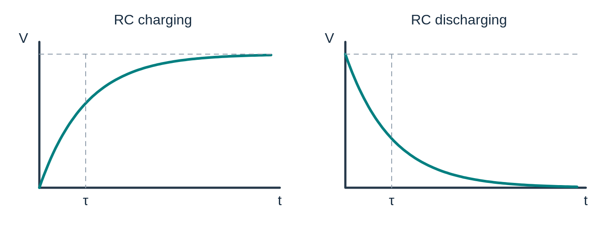

$$\tau=RC$$

从零电压充电：$V_C(t)=V_s(1-e^{-t/RC})$；从初始电压放电：$V_C(t)=V_0e^{-t/RC}$。一个时间常数后分别达到最终值的约 63.2% 和初始值的约 36.8%。

### 3.3 电感（Inductor）

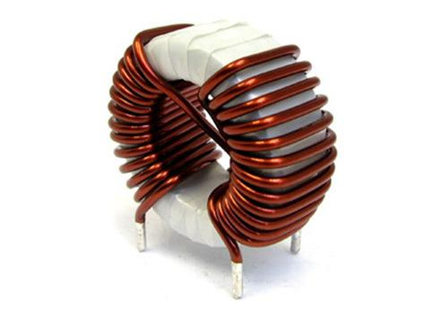

*课程原图：环形电感。*

- 符号 L，单位 H（亨利）；1 H = 1000 mH = 10⁶ μH。
- 以磁场形式储能，电感电流不能瞬间突变（有限电压条件下）。
- 理想电感在直流稳态下相当于短路，频率越高，感抗越大。
- 应用：电源、滤波、电机与继电器等感性负载。

$$X_L=2\pi fL$$

| 特性 | 电容 | 电感 |
|---|---|---|
| 储能 | 电场 | 磁场 |
| 理想直流稳态 | 断路 | 短路 |
| 高频信号 | 阻碍较小 | 阻碍较大 |
| 不能突变的量 | 电压 | 电流 |
| 主要应用 | 滤波、去耦 | 电源、感性负载 |

真实器件还有寄生参数，不能把理想特性无限外推到高频。

### 3.4 二极管（Diode）

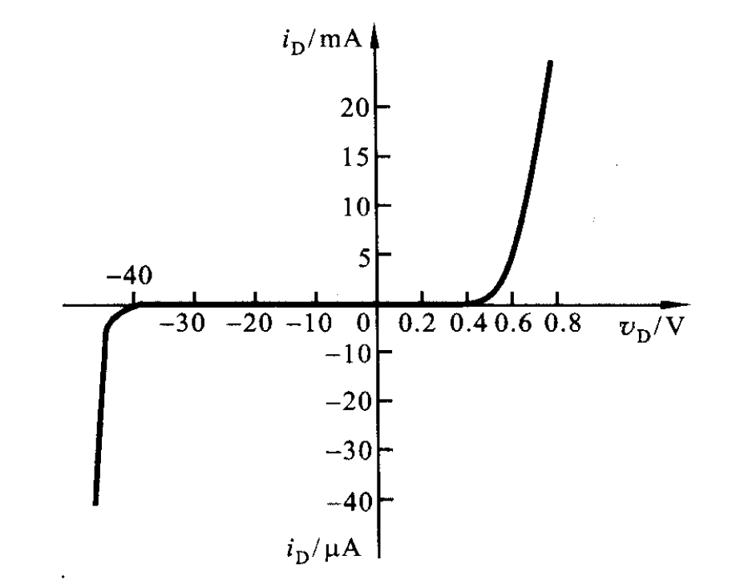

*课程原图：硅二极管伏安特性。*

核心是**单向导通**：正向偏置时电流随电压升高迅速增大，反向偏置未击穿时仅有很小的漏电流。普通硅二极管常见正向压降约 0.6–0.8 V，但取决于电流和温度。

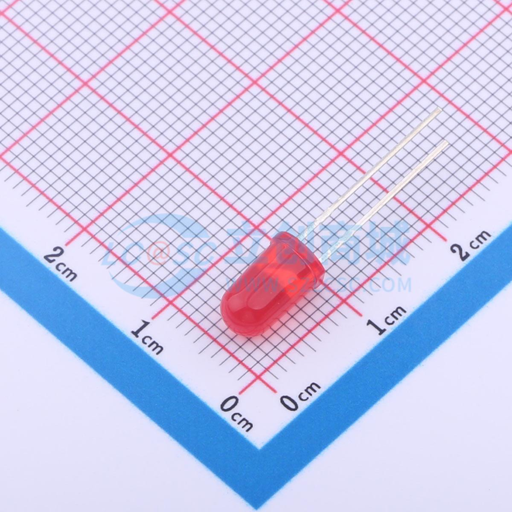

*课程原图：LED 实物。*

| 类型 | 主要用途 |
|---|---|
| 普通二极管 | 整流、防反接等 |
| 发光二极管 LED | 状态指示、照明 |
| 续流二极管（工程补充） | 为感性负载断电时的电流提供通路，保护开关器件 |

LED 的正向压降随颜色、器件和电流而变化；点灯时通常需要限流电阻。

### 3.5 三极管（BJT）

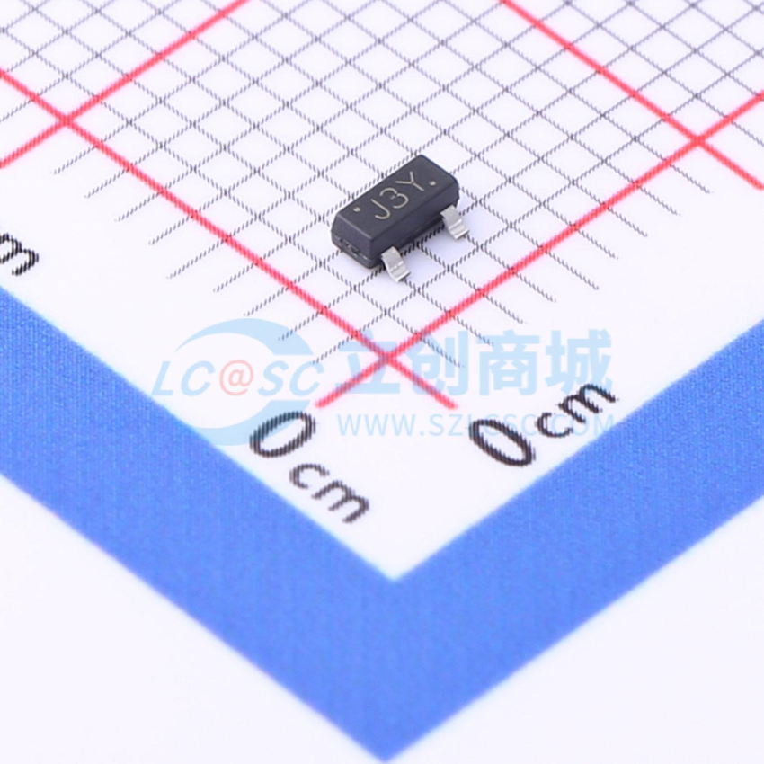

*课程原图：三极管实物。*

| 引脚 | 英文 | 作用 |
|---|---|---|
| B | Base | 基极，控制端 |
| C | Collector | 集电极 |
| E | Emitter | 发射极 |

三极管有 NPN、PNP 两类。嵌入式开发重点掌握其开关用途，理解基极电流控制集电极电流。

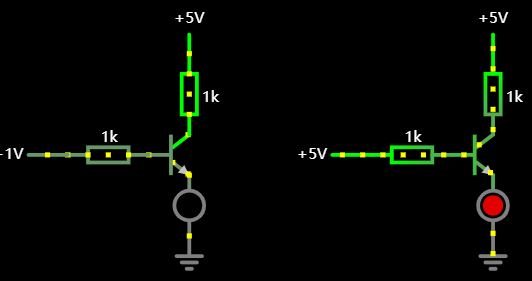

*课程原图：NPN 开关仿真。*

NPN 低侧开关：E 接地、负载连接电源与 C、B 通过限流电阻连接 GPIO。基极驱动充分时饱和导通；撤掉驱动后截止。

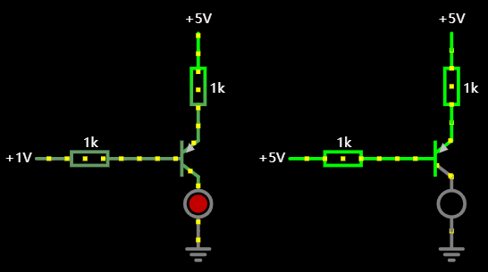

*课程原图：PNP 开关仿真。*

PNP 常用于高侧开关，基极电位低于发射极且有足够基极驱动时导通。驱动电平需与电源匹配，不能简单认为所有 PNP 都能直接由 3.3 V GPIO 控制。

| 工作状态 | 理解 | 当前要求 |
|---|---|---|
| 截止区 | 开关关断 | 掌握 |
| 饱和区 | 开关导通 | 掌握 |
| 放大区 | 电流放大 | 了解 |

### 3.6 MOS 管（MOSFET）

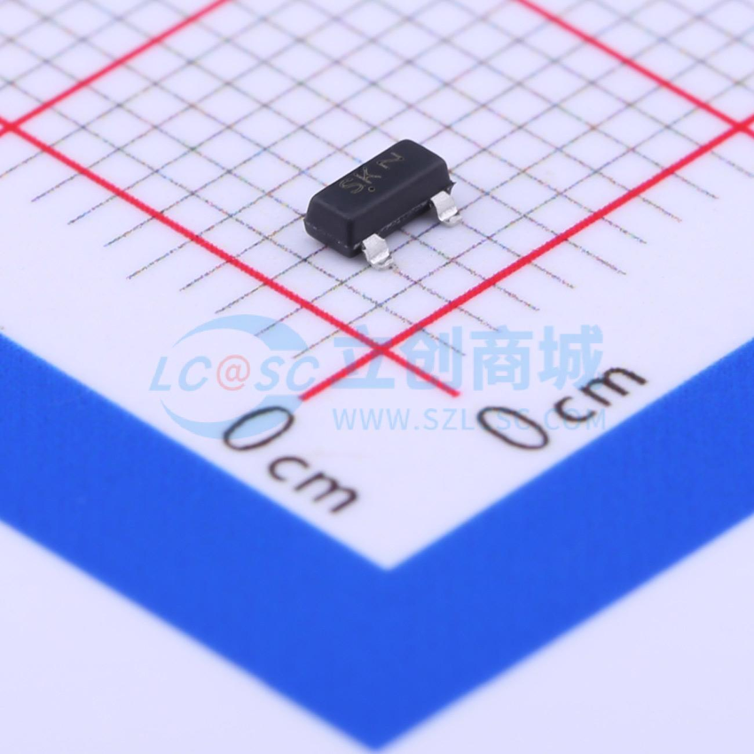

*课程原图：MOS 管实物。*

| 引脚 | 英文 | 作用 |
|---|---|---|
| G | Gate | 栅极，控制端 |
| D | Drain | 漏极 |
| S | Source | 源极 |

MOS 管通过栅源电压 $V_{GS}=V_G-V_S$ 控制沟道导通。重点学习增强型 N 沟道与 P 沟道。

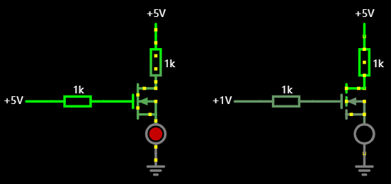

*课程原图：N 沟道 MOS 开关仿真。*

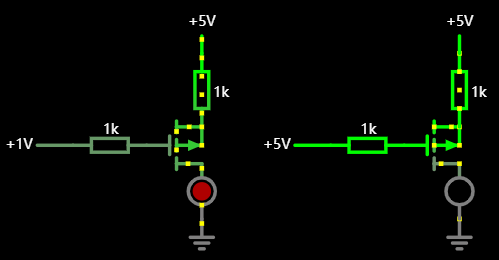

*课程原图：P 沟道 MOS 开关仿真。图中电平是示例，不能视为所有器件的统一开关阈值。*

- NMOS：足够正的 $V_{GS}$ 导通，常用于低侧开关。
- PMOS：足够负的 $V_{GS}$ 导通，常用于高侧开关。
- 重要参数：最大漏源电压、最大漏极电流、栅源电压限制、阈值电压及导通电阻 $R_{DS(on)}$。
- **阈值电压不等于充分导通电压**。3.3 V GPIO 驱动时，选择在相应栅源电压下有明确导通电阻规格的器件，必要时加驱动芯片。

| 对比 | BJT | MOSFET |
|---|---|---|
| 控制方式 | 基极电流 | 栅源电压 |
| 控制引脚 | B | G |
| 驱动特性 | 导通时需要基极电流 | 开关时需要栅极充放电 |
| 常见应用 | LED、蜂鸣器、继电器驱动 | 电机驱动、电源管理、开关 |

## 4. 六种典型电路

### 4.1 LED 限流电路

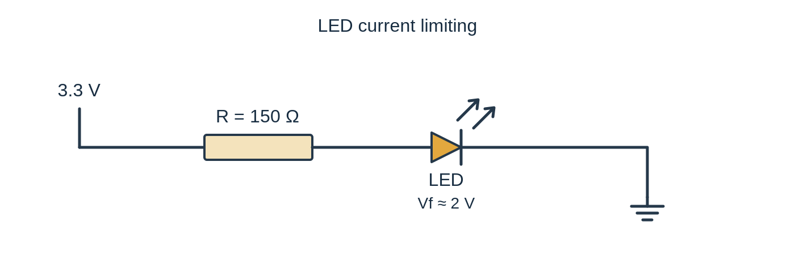

*自绘示意：LED 与限流电阻串联。*

$$R=\frac{V_{CC}-V_F}{I}$$

假设供电 3.3 V、LED 压降 2 V、目标电流 10 mA，则 $R=130\,\Omega$，实际可选 150 Ω，预计电流约 8.7 mA。使用 GPIO 直接点灯时，应检查引脚及整个端口的电流限制。

### 4.2 分压电路


*自绘示意：两电阻串联的空载分压电路。*

$$V_{out}=V_{in}\frac{R_2}{R_1+R_2}$$

例：输入 5 V，R1 = R2 = 10 kΩ，理想空载输出 2.5 V。若输入 12 V、R1 = 33 kΩ、R2 = 10 kΩ，则约为 2.79 V。

**工程补充：** 可用于 ADC 电压采集，但必须考虑最高输入电压、分压精度、ADC 输入范围、采样时间、源阻抗与保护。不要把高压直接接入 STM32 ADC，也不要仅凭 nominal 电压就断定安全。

### 4.3 上拉与下拉电路

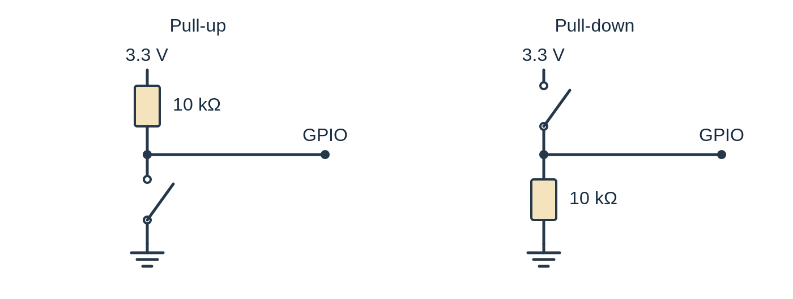

*自绘示意：左侧上拉、右侧下拉，开关均处于松开状态。*

| 状态 | 上拉（开关接地） | 下拉（开关接电源） |
|---|---|---|
| 松开 | 高电平 1 | 低电平 0 |
| 按下 | 低电平 0 | 高电平 1 |

输入引脚没有确定驱动时可能浮空，导致读取不稳定。上拉、下拉本质仍是电阻，只是连接方式和用途不同。STM32 GPIO 常见配置：No Pull、Pull-up、Pull-down。I2C 的开漏总线通常需要合适的上拉电阻。

### 4.4 RC 滤波电路

**低通滤波：** 串联 R、输出节点并联 C 到地，保留低频成分、衰减高频。

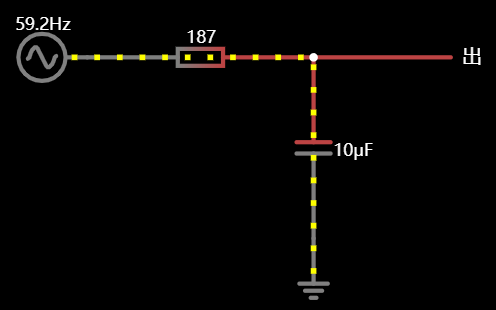

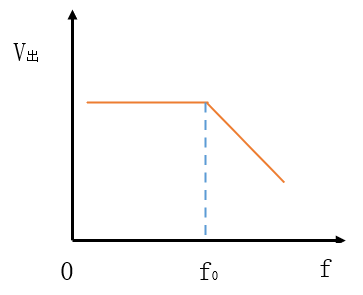

**高通滤波：** 串联 C、输出节点并联 R 到地，衰减低频成分、保留高频。

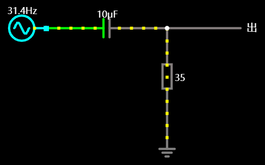

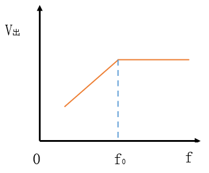

*以上四图均为课程原图，频率响应为定性示意。*

理想一阶 RC 滤波器：

$$f_c=\frac{1}{2\pi RC},\qquad \tau=RC$$

例如 R = 10 kΩ、C = 100 nF，则时间常数 1 ms，截止频率约 159 Hz。实际滤波并不是在截止频率处突然切断，截止点幅度为通带幅度的 $1/\sqrt{2}$（约 -3 dB）。

联系已有的 ECG 信号预处理经验：模拟滤波在 ADC 之前由物理电路完成，数字滤波则在采样后由算法完成，两者可以配合使用。

### 4.5 电源滤波与去耦电路

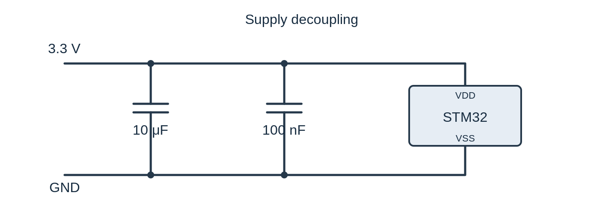

*自绘示意：示例去耦电容并联在供电与地之间。*

较大容量电容用于缓冲较慢的电压变化；小容量陶瓷电容常用于局部高频去耦，应靠近芯片电源引脚。实际数量、容值和布局以芯片资料为准。

### 4.6 开关驱动电路

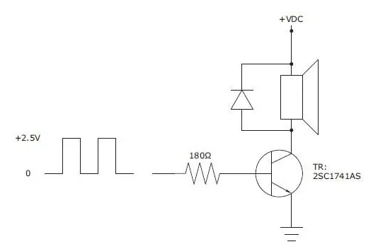

*课程原图：三极管驱动无源蜂鸣器电路。*

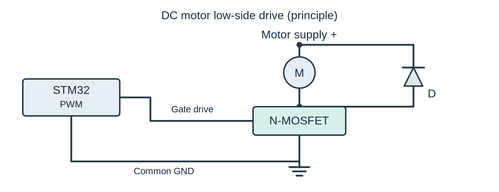

*自绘工程补充：单向直流电机低侧开关原理图，栅极驱动及 MOSFET 用功能框简化表示。*

GPIO 的作用是产生控制信号，不是直接为电机等大负载供电。低侧 NMOS 控制电机回路通断；PWM 调节导通比例，可用于调节平均驱动效果。电机具有电感，关断时应提供续流路径。图中二极管正常工作时反偏，关断时为电感电流提供通路。实际电机控制须检查堵转电流、器件额定值、栅极驱动、保护和供电；需要正反转时通常使用 H 桥驱动器。

## 5. 其他器件、电源与测量

### 5.1 其他器件

| 元件 | 需要了解的内容 |
|---|---|
| 继电器 | 线圈驱动、常开 NO、常闭 NC、触点额定值 |
| 保险丝 | 过流保护，额定电流与额定电压 |
| 有源蜂鸣器 | 内部有振荡源，通常适当直流供电即可发声 |
| 无源蜂鸣器 | 需要外部周期信号，常用 PWM |
| 电池 | 额定电压、容量 mAh；能量常以 Wh 表示 |
| 接插件 | 排针、排母、杜邦线、引脚间距和接线定义 |

### 5.2 稳压电源

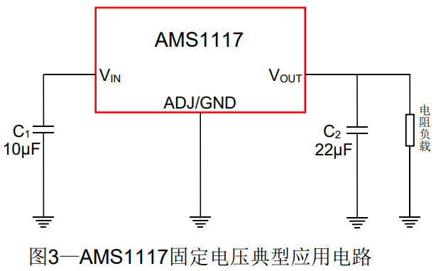

*课程原图：AMS1117 固定输出稳压电路示例。*

理解 5 V 转 3.3 V 的意义，以及输入范围、输出电压、最大输出电流、压差、散热。工程补充：LDO 是线性稳压器，降压时存在功耗 $(V_{in}-V_{out})I$；Buck 是常见的开关降压电路。当前只需理解用途与选型参数，不必深入设计控制环路。

### 5.3 万用表与示波器

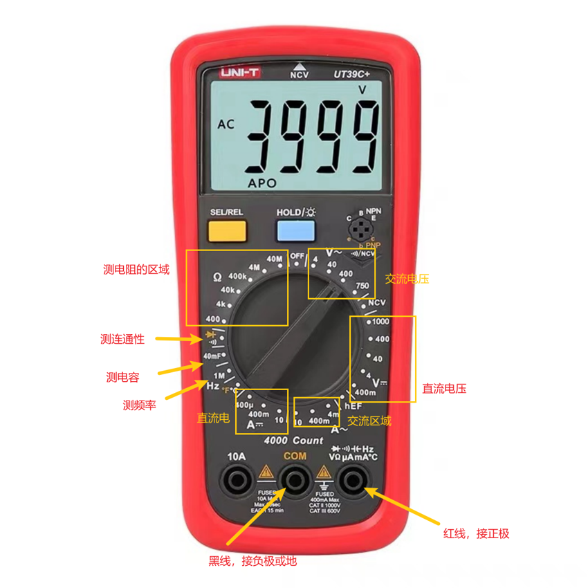

*课程原图：数字万用表。*

| 测量项目 | 接法与注意事项 |
|---|---|
| 电压 | 正确量程与插孔，并联测量 |
| 电流 | 正确电流插孔与量程，断电接入后串联测量；严禁电流档直接跨接电源 |
| 电阻 | 断电测量，必要时将器件一端脱离电路 |
| 通断 | 断电后测量线路是否连通 |
| 二极管 | 断电后使用二极管档，观察正向压降 |
| 电容 | 断电、确认安全放电后测量 |

示波器（工程补充）：认识电压波形、周期、频率、幅值、PWM 占空比和噪声。频率 $f=1/T$，占空比 $D=t_{on}/T$。初学仅在低压电路练习，注意示波器探头地夹的接地方式，避免短路；不操作市电和强电。

### 5.4 光感灯综合案例

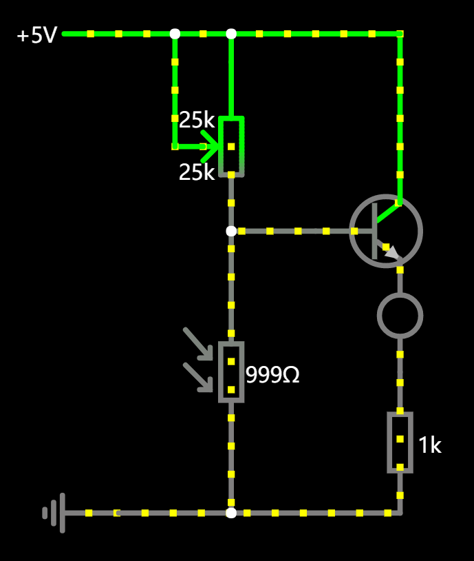

*课程原图：光敏电阻、分压和三极管开关组合。*

在该课件所示接法中，光照减弱，光敏电阻阻值升高，分压节点电压升高，三极管趋于导通，LED 点亮。实际效果取决于分压接法和三极管负载。理解从环境信号 → 阻值变化 → 电压变化 → 执行器响应的全过程。后续可将分压信号输入 ADC，由 STM32 软件决定控制逻辑。

## 6. STM32 知识对应关系

| STM32 外设或课程 | 对应硬件知识 |
|---|---|
| GPIO 输出点灯 | LED、限流、输出电流限制 |
| GPIO 输入、按键 | 上拉、下拉、浮空、高低电平 |
| EXTI 外部中断 | 电平变化、按键消抖 |
| ADC 模数转换 | 模拟信号、分压、滤波、采样范围 |
| DAC 数模转换 | 模拟电压、滤波 |
| TIM 定时器 | 周期、频率 |
| PWM | 占空比、三极管、MOS 管 |
| I2C | 开漏输出、上拉电阻 |
| 蜂鸣器 | 开关驱动与 PWM |
| 电机控制 | 感性负载、MOS 管、续流、驱动器 |
| STM32 最小系统 | 稳压供电、去耦、接地 |
| 传感器采集 | 分压、ADC、模拟滤波 |

## 7. 暂不需要深入的内容

| 内容 | 学习策略 |
|---|---|
| 原子结构、电子层、半导体物理 | 简单了解 |
| PN 结微观机制 | 理解单向导通即可 |
| 三极管放大电路、静态工作点 | 按需学习 |
| MOS 管制造工艺 | 暂不学习 |
| 复杂 RLC、频域推导 | 后续按需学习 |
| 运算放大器与比较器设计 | 学习传感器、模拟前端时再补充 |
| 高频电路、开关电源内部设计 | 暂不学习 |
| PCB 布线、强电设计 | 非当前学习重点 |

## 8. 七天学习计划

建议每天 1–2 小时，先理解，再进行低压电路仿真。使用 Apple Silicon Mac 无需专门安装 Windows，浏览器即可打开 CircuitJS。

| 时间 | 内容 | 实践与产出 |
|---|---|---|
| Day 1 | 电压、电流、电阻、功率、串并联 | 计算简单电路中各节点电压和电流 |
| Day 2 | 电阻、限流、分压、上下拉 | 搭建 LED 与按键仿真电路 |
| Day 3 | 电容、电感、充放电 | 观察 RC 波形与时间常数 |
| Day 4 | 二极管、LED、续流 | 仿真正向导通与反向截止 |
| Day 5 | 三极管、MOS 管 | 用控制信号驱动负载 |
| Day 6 | RC 滤波、稳压、去耦 | 比较高低频滤波效果 |
| Day 7 | 综合练习、原理图阅读 | 识别开发板供电、LED、按键、驱动模块 |

仿真工具：[CircuitJS 在线版](https://www.falstad.com/circuit/circuitjs.html)；[课程推荐的 CircuitJS 项目仓库](https://github.com/SEVA77/circuitjs1)。

## 9. 学习验收清单

- [ ] 理解电压、电流、电阻、功率及单位换算。
- [ ] 能够使用欧姆定律和功率公式完成计算。
- [ ] 能够分析简单串联、并联电路。
- [ ] 理解电阻、电容、电感的核心特性。
- [ ] 理解二极管单向导通、LED 和续流二极管用途。
- [ ] 能解释 NPN、PNP 三极管作为开关的工作方式。
- [ ] 能解释 NMOS、PMOS 的栅源电压控制原理。
- [ ] 能够计算 LED 限流电阻。
- [ ] 能够计算分压电路输出电压。
- [ ] 理解上拉、下拉和 GPIO 浮空状态。
- [ ] 理解 RC 滤波、电源去耦及时间常数。
- [ ] 能够阅读 STM32 基础外围电路原理图。
- [ ] 会使用万用表测量低压电路的电压、电阻和通断。
- [ ] 能解释 GPIO 为什么不能直接驱动电机，以及续流二极管的作用。

## 10. 后续具身智能学习路线

```text
电学基础 / 模拟电路（当前阶段）
    ↓
数字电路基础
    ↓
STM32 单片机开发
    ↓
FreeRTOS 实时操作系统
    ↓
传感器 / 电机驱动 / PID 控制
    ↓
Linux / ROS 2 / 机器人仿真
    ↓
Robot Learning：模仿学习、强化学习、VLA、运动控制
```

**不必等到完全掌握模拟电路再开始 STM32。** 能读懂 LED、按键、电源、分压和简单驱动电路，就可以开始后续课程。遇到 ADC 时再深入信号调理，遇到 PWM 和电机时再深入驱动与保护，遇到真实传感器时再学习运放和比较器。

最终目标是建立从硬件、传感器、嵌入式软件、机器人控制到上层 AI 模型的完整认知。

---

